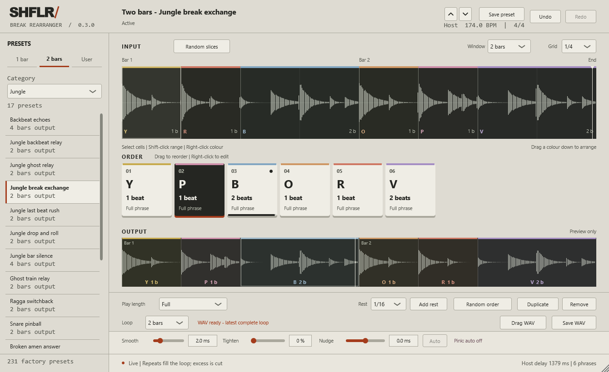

# SHFLR

SHFLR (Shuffler) is a live phrase-reordering VST3 effect for Windows x64, built with JUCE 8.0.12 and CMake. Incoming track audio refreshes Input; the larger Order cards arrange coloured phrases and rests into the audible output. A separate standalone WAV player is included.

[Download SHFLR 0.3.0 for Windows x64](https://github.com/sleepingsw0rd/SHFLR/releases/download/v0.3.0/SHFLR-0.3.0-Windows-x64.zip) · [Release notes](https://github.com/sleepingsw0rd/SHFLR/releases/tag/v0.3.0)



The **Sampler desk** puts a dark waveform above a row of ivory Order pads. Each pad identifies its source by letter and colour strip and shows its play length in beats. The source and pad light up together as the sequence plays. Use the left browser to choose one of 231 factory arrangements or recall your own.

## Kick builds and end shuffles

- **12 kick builds** under **Buildups**: six for each input length, all lasting **two output bars**. They repeat the first-beat kick, starting on quarter notes, accelerating through eighths and finishing on sixteenths. Choose earlier, later or stepped accelerations, plus gated variations with space between the early hits.
- **16 end shuffles** under **Fills**: eight for each input length. These keep the lead-in intact and shuffle only the last beat; **Last eighth flip** changes just the last eighth. One-bar versions repeat after one output bar; two-bar versions leave the first seven beats intact and shuffle the ending of bar two.
- **231 presets total**. All previous 203 names, arrangements, categories and factory indices are retained.

The input-length tab describes the live source window. For a two-bar kick build, select either source tab to match your break, then choose a **Kick build** preset: its row will show **2 bars output**. These presets deliberately retrigger only the first source beat throughout, including with a two-bar source. They do not switch to a snare or another source hit as they accelerate. Drum names assume a kick at the source start; adjust the source region if your break starts elsewhere.

## Smooth, Tighten and Nudge

Start with Smooth around 2-3 ms. Increase it if joins sound abrupt; reduce it if short rolls or attacks feel softened. Smoothing blends incoming pre-roll before a source jump, leaving the incoming attack at its scheduled position. At a Rest, audio fades within its own duration so the rest stays exactly silent. Very short phrases limit their fade length automatically.

Tighten searches up to 30 ms either side of each colour's source start, limited further for short regions. It prefers clear, sustained attacks and rejects uncertain or ambiguous candidates. 50% applies half the detected correction; 100% applies all of it. The choice stays fixed for repeated reads of the same source occurrence and refreshes for new incoming audio. Detection is an aid, not drum recognition: vinyl noise, layered hits and softer attacks can produce no match or an unsuitable match. Use Nudge when needed. Immediately after a fresh start, a source at the very beginning may lack preceding audio for detection; later complete passes can detect it.

Select a source colour in Input or one of its Order cards, then adjust Nudge. Positive values read later in the source, bringing a late attack earlier in Output; negative values read earlier, which can recover a pickup or delay an entrance. Nudge moves the whole read window without changing its duration, so it can include nearby audio outside the painted colour region or trim its tail. The marker shows the shifted start. Rest, unassigned and mixed-colour selections do not have a Nudge target. Typing zero sets a manual zero override; Auto removes it.

Tighten adjusts phrase entrances only: a three-beat region keeps the timing of the hits inside those three beats. It does not warp drifting material or quantise every hit. Automatic detection reserves up to 45 ms beyond arrangement lookahead where needed; manual positive offsets can also increase lookahead. The total is reported to the host and shown in the footer. Settings do not add a full-bar capture stage. If Cubase needs to refresh delay compensation after a change, stop and restart playback.

## Included features

- A permanent left preset browser groups Factory presets by **1 bar / 2 bars of input**, then **DnB, Jungle, Hip-hop, Buildups, Breakdowns, Shuffles, Fills**, plus **Essentials**. Preset rows show output-loop length. User saves remain in their own tab. Minimum editor size is 1140 x 740; default is 1340 x 820.

- Each source Order card has its own **Play length**: Full or a shorter duration, always starting from the colour's beginning without stretching. Select a card and use the bottom chooser, or right-click **Play length**. For a three-beat Yellow region, three Yellow cards set to Full / 2 beats / Full produce **3 + 2 + 3 beats** in a two-bar output loop.
- Large Order cards show duration, playback progress, repeats, loop-end cuts and unused occurrences. Length overrides follow drag/reorder, duplicate, undo, User presets and project recall. Older presets load with Full durations; Shuffle keeps each card's length and New sequence starts with Full phrases.

- Factory patterns include first-three/six-beat repeats, kick/snare onset rolls, jungle/DnB chops, hip-hop gaps, buildups, breakdowns, shuffles and fills.
- **Rest blocks** add exact-duration silence in Order without consuming a source colour. Choose 1/16, 1/8, 1/4, 1/2 or one bar, then **Add rest**. Incoming audio keeps recording through every rest.
- Rest-aware saving, recall, undo, randomisation and WAV export; older presets/projects remain readable. New sequence avoids adding rests to a pattern that has none.
- The earlier three-beat and jungle/DnB factories remain included.
- Up/down buttons cycle the browser's visible presets. During playback, the latest selected preset waits for the next output-loop boundary or earlier DAW cycle wrap. A **Queued - next loop** indicator shows the remaining beats.
- Input-window changes preserve usable audio history. Preset status distinguishes waiting for a loop, filling missing audio, and active playback.
- Fixed WAV export remaining unavailable when the host rounds loop boundaries or musical positions to audio samples, including two-bar loops at 174 BPM.
- Preset saving now stays inside SHFLR: enter a name, Save, and select it under User. No preset file dialog is needed.
- Arrangement-dependent lookahead replaces the fixed input-window delay. The original Y/Y/Y/B/R/R arrangement needs zero lookahead; moving a late phrase to the front still needs the corresponding delay.
- Order cards provide shuffle and new-sequence actions. Input has its own slice randomisation.
- A managed User preset library and project-state recall.
- Drag WAV and Save WAV export the latest complete wet output loop as a 24-bit WAV.
- SHFLR branding, readable help/menu text, and a standalone player with a headless render command.

## Install the VST3

Close Cubase before replacing the old plugin. Extract the ZIP and copy the **entire `SHFLR.vst3` folder** into `C:\Program Files\Common Files\VST3`. It replaces Break Var: move the old `Break Var.vst3` bundle out of the scan path rather than keeping both, because the plugin identity deliberately stays the same for existing projects. Rescan if needed, then insert **SHFLR** on a mono or stereo audio track.

Use normal host delay compensation during playback. The host receives latency updates after the first audio block supplies its tempo and after arrangement changes. If Cubase does not refresh compensation while playing, stop and restart. Host testing and listening remain to be done by the user; the release has command-line and software-rendering verification.

## Arrange

- Input window: 1, 2 or 4 bars. Grid: 4, 8 or 16 divisions per bar, following the host meter.
- Select adjacent cells and right-click one of eight colours. Each colour occupies one continuous region; edits cannot remove a region still referenced by Order.
- Drag a coloured phrase into Order. Drag cards to reorder; right-click, duplicate, remove, or use Undo/Redo. Newly inserted occurrences play Full; change **Play length** to trim an individual card. Choices use sixteenth-bar increments (quarter-beat increments in 4/4), independent of the source selection grid. Durations are displayed in host quarter-note beats.
- Full follows the source region's length. A fixed play length remains an upper limit if the source region shrinks or Input changes: it plays only the available source, with no extra silence or stretching. Expanding the source can restore the saved limit. Random slices preserves these limits.
- Output is an arrangement preview made from the live source waveform peaks. Edit Input colours and Order cards to change it; the preview itself is noninteractive. Shorter cards preview only the beginning of their source region.
- Output loop: 1, 2, 4 or 8 bars, selected in the bottom toolbar. The order repeats to fill it; cards report **Cut at loop end** or **Repeat cut at end** when an occurrence crosses the endpoint. Entries beyond the first pass's loop end are dimmed and marked **Not played**. The active card highlights and shows progress. An empty order is silent. Scroll Order to reach longer arrangements.
- Random slices partitions Input on the current grid, retaining all colours referenced by Order. Random order offers **Shuffle existing** (same occurrences) and **New sequence** (new occurrences from assigned colours). Each operation is one undo step.
- Choose a rest duration beside **Add rest**. It inserts after the selected Order box or appends if none is selected. Drag it into position; an occurrence beyond the chosen output length remains dimmed until moved into the audible loop. Right-click a rest to change its length, duplicate or remove it. Rest lengths are fractions of a bar and do not change when the input selection grid changes.
- **Shuffle existing** keeps every rest occurrence. **New sequence** can reuse rest lengths already present, but never invents rests in a rest-free pattern. Random slices changes source regions without changing rest durations. Deliberately all-rest arrangements are supported and export silence.

The Original preset uses a two-bar source: Yellow for three beats, Red for two, Blue for three in 4/4. Y/Y/Y/B/R/R fills four output bars. The factory collection includes straight layouts, half/bar swaps, rotations, repeats and closing fills for one- and two-bar breaks.

**First three beats** repeats one continuous phrase containing source beats 1–3. The one-bar version fills two output bars; the two-bar version fills four. **Three beat pendulum** alternates the first three beats of each source bar; **Three beat tail** and **Three beat answer** add turnarounds. Jungle/DnB entries include backbeat exchanges, ghost steps, snare rushes, kick returns and short tail fills. Align the source break to a bar start and choose the matching input length. These are grid-based starting arrangements for Amen/Think-style breaks; drum names describe the intended rhythm, not automatic hit recognition. They have render checks but still need listening approval.

**First six beats** repeats source beats 1–6 as one continuous phrase from a two-bar input, filling four output bars; **First six beats long** fills eight. The final repeat is cut at the chosen endpoint. **Six beat turn**, **Kick return**, **Snare return** and **Six beat stop** add variations.

Kick rolls use a short slice starting on source beat 1; snare rolls start on beat 2. Eighth, sixteenth, double and accelerating variations retrigger those onsets. Combined presets include **Jungle kick snare rolls**, **DnB roll exchange**, **Jungle roll crescendo** and **Hip hop double tap**. Rest-based patterns include **Hip hop kick/snare gaps**, **Jungle stop start**, **DnB gated eighths**, **Jungle drop and roll**, **Half bar dropout**, **Hip hop cutaway** and **Jungle bar silence**. Beat names and roll divisions assume 4/4. Different break edits may place their hits elsewhere; move/reassign source colours to suit the recording. There is no pitch change or velocity processing.

## Presets and WAV export

Use the left browser's **1 bar** or **2 bars** tab to match the input break, choose a **Style / purpose**, then click a preset. These tabs describe the live input window; each row separately shows its output-loop length. **Up/down** wraps around the visible category, or around your saved presets when the **User** tab is selected. Browsing a category does not change the current arrangement. The current name and queued/active status remain in the main header.

Click **Save preset**, type a name inside the plugin, and click **Save**. The browser reveals the saved entry under **User**. Existing names require a second explicit **Replace** click. Cancel leaves the saved preset unchanged. Names are case-insensitive and up to 64 characters. A User preset can share a Factory name without replacing the Factory entry.

During playback, Input and Order show the selected arrangement immediately while the old arrangement finishes its current loop. **Queued - next loop** stays visible until the switch; clicking again replaces the pending choice. A shorter DAW cycle also provides a switch point so the selection cannot wait indefinitely for a longer output loop. Stopping makes the choice ready for the next start; when a host suspends all callbacks without a Stop event, SHFLR detects the pause after a short timeout. **Filling input...** means the selection is applied but required source audio has not yet arrived. **Active** means it is processing. Manual pattern edits and Undo/Redo remain immediate.

Changes in required lookahead still require a host delay-compensation update. This release retains the low arrangement-dependent delay; it does not promise a gapless transition between presets with different delays or after seeking. Stop/restart if the host needs that to refresh compensation.

SHFLR manages the User library automatically in `%APPDATA%\SHFLR\Presets`, shared by the VST3 and standalone and available across projects. There is no location to choose or external file to manage. Presets contain lengths, grid, colours, order and rests, not audio. The active arrangement remains embedded in the DAW project, including when its User library is unavailable on another computer. Older version-1 and version-2 states remain readable with Full playback lengths, and version-3 states retain their saved lengths; new saves use version 4 and require SHFLR 0.2.6 or later to load. Per-card lengths and all sound controls are included in presets and project state.

**WAV ready** appears after a complete valid output loop has played. Drag WAV exports that loop into a persistent `Documents\SHFLR Exports` file and starts a normal file drag; Save WAV writes to your selected location. Exports include the audible repeats, final cut and join fades, at the current processing sample rate. Stopping retains the completed loop. Changing the arrangement, seeking, changing timing or preparing a new audio configuration invalidates it. Export loops are limited to **32 seconds**; longer loops still play within the history limit. Exported files are retained because a DAW may reference them.

## Standalone player

Run `SHFLR.exe`, choose **Open WAV**, set the file's **source bars** (1, 2 or 4), then Play. Dropping a WAV onto the window also loads it. Source bars determines tempo from the file's exact duration in 4/4; there is no half/double-tempo guess. This setting is separate from the plugin's Input window. Use Audio settings to choose the output device. Audio starts only when Play is pressed. Stop keeps the last complete export.

The standalone feeds the same live effect from a looping WAV. It does not add sample loading to the VST3. Files up to 120 seconds at 8-384 kHz are accepted; resampling to the device rate happens before playback.

For noninteractive checks, without opening a window or audio device:

```powershell
.\SHFLR.exe --render input.wav output.wav 0 2 --sample-rate 48000 --block-size 257
```

The two positional numbers are the zero-based factory index and the WAV's source-bar length. Both are optional; defaults are Original and that preset's Input length. Optional render flags: `--smooth-ms 2.5`, `--tighten 50`, and the paired `--nudge-colour 0 --nudge-ms -12.5` (colour indices 0-7). The JSON report includes applied source offsets and detection states.

The command writes one complete output loop plus `output.wav.render.json`, and returns a nonzero exit code on failure.

`SHFLR.exe --catalog catalog.json` writes the complete Factory catalog, including stable indices, categories, source/output bars and arrangements, without a window or audio device. This is useful for automated rendering checks.

## Timing and limits

SHFLR uses only audio that has actually arrived. It does not substitute an earlier source cycle to avoid lookahead. Starting or seeking can therefore leave unavailable samples silent until the required history exists. At steady host tempo, slices keep their timing without stretching. Tempo and meter changes refill history; seamless tempo automation is not supported. Input-length changes preserve available source history and refresh the waveform view. Expected DAW cycle wraps preserve history when their timing is continuous.

Bypass retains the declared delay. Playback without valid musical host timing is silent. Adjustable smoothing at source jumps suppresses edit clicks. History is bounded to 120 seconds; unsupported timing is indicated. Free snapping and draggable block boundaries remain deferred.

## Build

Requires Visual Studio 2022 C++ tools, Windows SDK, CMake 3.22+, and JUCE 8.0.12. An existing JUCE checkout avoids downloading:

```powershell
.\build.ps1 -JuceSource C:\path\to\JUCE -Package
```

The script builds VST3, standalone and five test targets, runs CTest, then packages both binaries and this guide. Tests include software-only editor rendering without a native window. It never installs or opens either application interactively. Pure model/engine/library tests can be configured with `-DBREAKVAR_BUILD_PLUGIN=OFF`.

Build outputs: `build/BreakVar_artefacts/Release/VST3/SHFLR.vst3` and `build/SHFLRStandalone_artefacts/Release/SHFLR.exe`. The ZIP is `dist/SHFLR-0.3.0-Windows-x64.zip`. JUCE retains its own licence; see its source licence before distribution.
